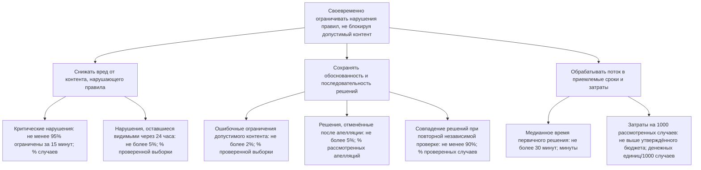

# Лабораторная работа 2. Структура и дерево целей

**Тема:** модерация пользовательского контента по правилам площадки

## 1. Границы системы и цель

Рассматривается система, которая принимает публикации и жалобы пользователей, проверяет контент на соответствие правилам площадки, ограничивает нарушающие публикации и позволяет обжаловать решение. В систему входят автоматические проверки, модераторы, правила, интерфейс модерации и процесс апелляции. Создание самих публикаций и внешние органы правоприменения находятся за её границами.

**Цель системы:** своевременно ограничивать контент, нарушающий правила, при этом не удалять допустимый контент и обеспечивать последовательность решений.

Площадка и её фактические данные в задании не указаны. Поэтому пороговые значения ниже — предлагаемые критерии для пилота, а не утверждения о текущих результатах конкретной компании. Их нужно уточнить после измерения исходного уровня.

## 2. Декомпозиция системы

### По функциям

1. **Приём сигналов:** получать публикации, жалобы и повторные обращения.
2. **Первичная фильтрация:** автоматически находить вероятные нарушения и назначать приоритет.
3. **Проверка по правилам:** сопоставлять содержание и контекст публикации с правилами площадки.
4. **Принятие и исполнение решения:** оставить публикацию, ограничить её видимость или удалить; уведомить пользователя.
5. **Апелляция:** повторно проверить оспоренное решение и при необходимости отменить его.
6. **Контроль качества:** проводить выборочную проверку решений, отслеживать ошибки и обновлять инструкции.

### По составу системы

1. **Пользователи и авторы контента** — публикуют материалы и отправляют жалобы или апелляции.
2. **Правила площадки и база примеров** — задают категории нарушений и критерии решения.
3. **Автоматические средства** — фильтры, классификаторы, очереди и приоритизация случаев.
4. **Модераторы и руководитель смены** — рассматривают случаи, включая неоднозначные.
5. **Команда политики и безопасности** — уточняет правила и разрешает сложные или прецедентные случаи.
6. **Сервис апелляций и поддержки** — принимает повторные обращения и возвращает решение пользователю.
7. **Журналы и аналитика** — фиксируют сроки, решения, жалобы, результаты апелляций и контрольных проверок.

**Сравнение.** Функциональная декомпозиция показывает путь случая от поступления сигнала до контроля качества: по ней видны этапы, задержки и места передачи работы. Но она не показывает, какие люди и средства выполняют этапы и где находится ответственность. Декомпозиция по составу показывает участников, инструменты и источники данных, однако сама по себе не объясняет последовательность обработки и зависимость результата от каждого этапа. Вместе они дают и процессную, и организационную картину системы.

## 3. Дерево целей

Показатели на листьях имеют единицы измерения и указанный источник. Порог — начальный критерий пилота; его следует пересмотреть по исходным данным и уровню риска площадки.

**Как получить значения:** сроки и медиану рассчитывать по временным меткам журнала модерации; долю оставшихся нарушений и ошибочных ограничений — по независимому аудиту случайной выборки с повторной оценкой по правилам; долю отмен — из журнала апелляций; согласованность — из повторной слепой проверки несколькими модераторами; затраты — из учёта рабочего времени и расходов на инструменты, делённых на число рассмотренных случаев. Для выборочных показателей нужно фиксировать период, размер выборки и категории риска.

На этом уровне дерево останавливается: каждый лист задаёт конкретный показатель, единицу, способ получения и предварительный критерий достижения. Дальнейшее разложение описывало бы уже меры (например, обучение модераторов), а не результат, которого должна достичь система.

## 4. Конфликт целей

Конфликтуют ветви **снижения вреда** и **сохранения обоснованности решений**. Если ради скорости и минимального числа пропущенных нарушений автоматически блокировать больше публикаций, вырастет доля ошибочных ограничений допустимого контента. Если же каждый неоднозначный случай тщательно проверять вручную, увеличатся время решения и объём потенциально вредного контента, остающегося видимым. В текущей модели оперативный спор решает руководитель смены, а изменение трактовки правила или решение по прецедентному случаю эскалируется команде политики и безопасности; компромисс следует оценивать совместно по задержке, ошибочным ограничениям и результатам апелляций, а не только по числу удалений.

## 5. Проседающая ветка

Сейчас проседает ветка **обоснованности и точности модерации**. Основание — качественное наблюдение автора за Ozon и Wildberries: встречаются ошибочные блокировки карточек допустимых товаров, запрещённые товары могут оставаться доступными, а обращения продавцов не всегда приводят к пересмотру решения. Источник этого вывода — наблюдения автора, подтверждённые в обсуждении работы; он не основан на внутренней статистике площадок. Поэтому вывод указывает направление проблемы, но не её масштаб. Для количественной оценки нужны данные за определённый период о блокировках, жалобах и результатах апелляций.
