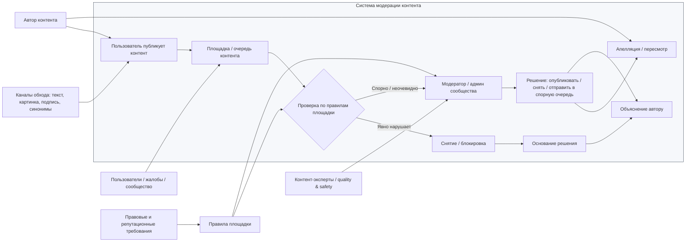

# Лабораторная работа №1
## Тема: AI Content Moderation

### 1) Контекстная диаграмма

### 2) Границы системы

Внутри системы:
- правила площадки и их интерпретация;
- очереди контента и сигналы жалоб;
- проверка публикаций по тексту, изображениям и их сочетанию;
- действия модератора: допуск, снятие, спорная очередь, апелляция;
- объяснение решения автору и фиксирование основания.

Вне системы, но влияет на неё:
- пользователи и авторы публикаций;
- сообщество и жалобы на контент;
- юридические и этические требования к площадке;
- способы обхода правил: скрытый текст, картинка вместо текста, подписи, синонимы;
- внешние источники и публичные наборы данных для проверки.

Что не относится к системе как к текущей задаче:
- отдельный коммерческий продукт/платформа с готовой AI-моделью;
- полный ретроанализ всех ML-алгоритмов в компании;
- разработка модели как самоцель; важен именно процесс решения задачи "как сейчас" без продукта.

Спорный элемент: AI-модель. В этой системе она не является отдельной организационной единицей, а только возможным инструментом внутри процесса: она может помогать в классификации, но человек остаётся ответственным за финальное решение и объяснение, потому что цена ошибки разная и решение затрагивает права автора.

### 3) Таблица заинтересованных сторон

| Заинтересованная сторона | Цель | Как проявляется в системе | Конфликт с другими целями |
|---|---|---|---|
| Модератор площадки / админ сообщества | Быстро и корректно оценивать спорный контент, не перегружать себя рутиной | Проверяет жалобы, решения и апелляции | Должен быть и быстрым, и строгим; при ошибках теряет доверие |
| Автор контента | Не получить ложное снятие и иметь возможность обжаловать решение | Отправляет материалы, получает основание и апелляцию | Не хочет спорных блокировок, но площадка должна защищать пользователей |
| Пользователи сообщества | Видеть безопасную среду, без вредного и запрещённого контента | Жалобы, наблюдение за качеством контента | Не готовы мириться с ложными пропусками или чрезмерной цензурой |
| Владельцы площадки / продуктовая команда | Сохранить репутацию, снизить риск, масштабировать обработку | Определяют правила и SLA | Нужно сократить трудозатраты без ухудшения качества |
| Compliance / legal / safety | Соблюдать правила, минимизировать юридические и репутационные риски | Формируют правила, оценивают спорные случаи | Может требовать более жёсткую фильтрацию, чем пользователи готовы принять |
| Quality & Safety / эксперты | Поддерживать прозрачность, объяснимость и качество решений | Фиксируют баги, провоцируют обходы и проверяют несоответствия | Иногда конфликтуют с темпом и экономией ресурсов |
| Авторы обходов / нарушители | Обойти правила и ускользнуть от блокировки | Пишут текст в изображениях, маскируют запрещённый контент | Противоречат интересам почти всех остальных сторон |

### 4) Записка: цель системы и её достижение

Система — это процесс модерации контента на платформе, где публикации проверяются по правилам площадки, спорные случаи уходят к человеку, а решения должны быть объяснимы и обжалованы. Она существует, чтобы отделять допустимый контент от запрещённого и одновременно не перегружать человека рутинной проверкой, сохраняя прозрачность и доверие к платформе.

Цель системы: обеспечить безопасный и понятный поток контента, в котором явные нарушения быстро блокируются, а спорные случаи решаются человеком по правилам, с объяснением и возможностью апелляции.

Достижение этой цели видно по четырём признакам:
1. публикации, явно нарушающие правила, реально удаляются или помечаются; 
2. спорные случаи доходят до модератора, а не автоматически блокируются; 
3. автор получает объяснение: какой пункт правил нарушен и по каким признакам; 
4. модератор тратит время не на рутину, а на неочевидные случаи, а количество ошибок и жалоб уменьшается.

Граница системы проведена так: внутри — правила, контент, проверки, человек-модератор, апелляции; снаружи — пользователи, боты, нарушители, требования закона, рыночные репутационные риски; не являются частью системы как основной задачи — поведенческие аспекты платформы и её коммерческая стратегия без прямой связи с содержимым.

### 5) Три наблюдения из похода в систему

1. Вчера, 18:40, в модераторском чате сообщества после публикации мема с заголовком “проверка на грани” мы смотрели пост, в котором текст был в комментарии, ключевая часть — в картинке, а “подсказка” к смыслу откладывалась в подписи. Внутри одного и того же сообщения можно было увидеть три разных носителя: обычный текст, изображение и скрытый контекст. Это удивило тем, что один пост нельзя было оценить по одному признаку: правило оказалось применимым только после сборки смысла из нескольких частей, а не по отдельному фрагменту.
2. Сегодня, 12:15, в очереди жалоб на модерацию один пользователь прислал пост с отсылкой к запрещённой теме, но под видом новостной заметки: слова были разбросаны по алфавиту, а основная угроза скрывалась в визуальном оформлении и окружении. В этот момент модераторы обсуждали, что лучше временно снять такой материал, даже если формально слова “не запрещены” в одном месте, потому что в реальном канале такой пост распространяется мгновенно и обходить правило гораздо проще, чем потом исправлять последствия. Это вывело на важный принцип: цена ошибки в этой системе асимметрична, и для площадки пропуск вредного контента оказывается значительно дороже, чем одна ложная блокировка в спорной публикации.
3. Вчера, 20:05, в приёмной очереди модератора после апелляции автор спорил не с тем, “что система посчитала”, а с тем, “почему к его посту применили именно этот пункт правил”. В одном случае пост был снят, но модератор занёс в решение конкретную формулировку: “нарушено правило о запрете на скрытую пропаганду в изображении”, и только после этого автор успокоился и понял, что спор идёт не о предвзятости, а о точности применения правила. Это было неожиданно важным, потому что в реальной системе модерация оказалась не просто фильтром, а процедурой объяснения: без конкретного основания правила начинают обходить, жалобы становятся бессмысленными, а доверие к платформе падает.

---

Кратко: текущая система — это человеческая и полуавтоматическая модерация контента по правилам площадки; её цель — удерживать безопасный поток контента при массовом масштабе и сохранять объяснимость решений. По этому критерию её можно считать успешной, если уменьшается число пропусков вредного контента, снижается нагрузка на модератора и жалобы с апелляциями становятся управляемыми.
